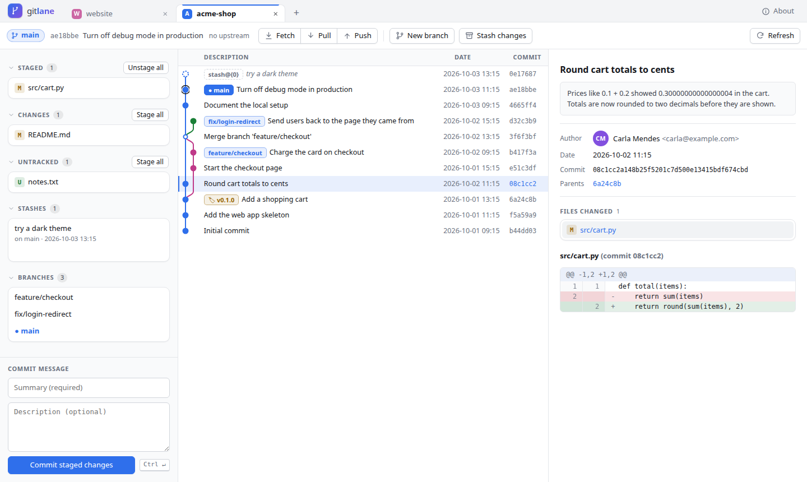
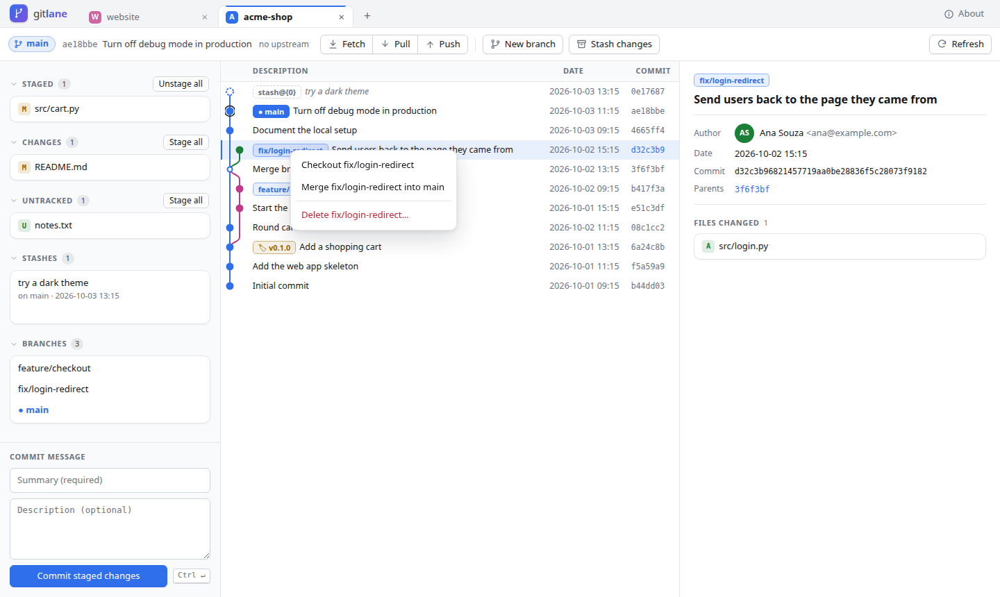

# gitlane

**A free, open-source Git client that runs in your browser.** Commit, push, pull, see the
commit graph, manage branches and stashes — in a clean local web app, with one command.

<picture>
  <source media="(prefers-color-scheme: dark)" srcset="https://raw.githubusercontent.com/gustavojoseleite/gitlane/main/docs/screenshots/main-dark.png">
  
</picture>

## Features

- **Changes** — see changed, staged and untracked files; stage, unstage or discard whole files; commit with a summary and description
- **Diffs** — for your working files and any commit, with **before/after previews for images**
- **Commit graph** — all branches with colored lanes, branch/tag labels and your stashes; fast on repositories with tens of thousands of commits
- **Right-click menus** — checkout, create a branch, cherry-pick, revert, reset (soft / mixed / hard), merge, delete branches (also on the remote)
- **Sync** — fetch, pull, push, and force push that always uses `--force-with-lease`
- **Stash** — save (including untracked files), apply, pop, drop, and look inside a stash
- **Merge conflicts** — see the conflicted files, then *abort* or *mark resolved and commit*
- **Tabs** — several repositories at once; recent repos and a folder browser to open more
- **Safe by default** — dangerous actions ask first; runs only on your computer (see [Security](#security))
- Light and dark theme (follows your system)



## Install

You need **Python 3.10+** and **Git 2.23+** (most systems already have both).

The recommended way is [pipx](https://pipx.pypa.io/) or [uv](https://docs.astral.sh/uv/). They
install gitlane in its own environment, so it never conflicts with your other Python projects:

```bash
pipx install gitlane
# or
uv tool install gitlane
```

Just want to try it, without installing anything? With uv:

```bash
uvx gitlane
```

<details>
<summary>Don't have pipx or uv yet?</summary>

| System | Install pipx |
|---|---|
| Ubuntu / Debian | `sudo apt install pipx && pipx ensurepath` |
| Fedora | `sudo dnf install pipx && pipx ensurepath` |
| macOS | `brew install pipx && pipx ensurepath` |
| Windows | `py -m pip install --user pipx` then `py -m pipx ensurepath` |

Open a new terminal afterwards so the `gitlane` command is found.
</details>

<details>
<summary>Install the latest development version from GitHub</summary>

```bash
pipx install git+https://github.com/gustavojoseleite/gitlane
```
</details>

**Update:** `pipx upgrade gitlane` (or `uv tool upgrade gitlane`)
**Uninstall:** `pipx uninstall gitlane` (or `uv tool uninstall gitlane`)

## Usage

```bash
gitlane                      # inside a repository: open it
gitlane ~/dev/my-project     # open a specific repository
gitlane                      # anywhere else: reopen your tabs, or pick a repository
```

gitlane starts a small server on your computer and opens it in your browser. Keep the terminal
open while you use it; press **Ctrl+C** to stop. Use **+** next to the tabs to open more
repositories. Open tabs and recent repos are remembered.

| Option | What it does |
|---|---|
| `--port 8000` | use a fixed port (default: a free one) |
| `--no-browser` | only print the link, don't open the browser |
| `--install-launcher` | add gitlane to your app menu (Linux) |
| `--remove-launcher` | remove it from the app menu |
| `--version` | show the version |

**Keyboard:** `↑` `↓` move through commits · `Enter` open · `R` refresh · `Ctrl+Enter` commit ·
`Esc` close menus and dialogs. Drag the dividers between panels to resize them (double-click to reset).

### Push and pull: logging in

gitlane uses **your own Git setup** and never asks for or stores passwords. If `git push` works in
your terminal without typing a password, it works in gitlane too.

- **SSH remotes** (`git@github.com:you/repo.git`) — recommended. Set up an SSH key once:
  [GitHub guide](https://docs.github.com/en/authentication/connecting-to-github-with-ssh).
- **HTTPS remotes** (`https://github.com/you/repo.git`) — need a credential helper, for example
  `gh auth setup-git` ([GitHub CLI](https://cli.github.com/)) or
  [Git Credential Manager](https://github.com/git-ecosystem/git-credential-manager).
  Or switch the remote to SSH: `git remote set-url origin git@github.com:you/repo.git`

## Security

gitlane is a local app, but a web server on your computer still needs care:

- It listens **only on `127.0.0.1`** — other computers can't reach it.
- Every start creates a **secret token** in the link; without it every request is refused.
  The token is then kept in a cookie that other websites can't use.
- It rejects requests from other websites (Origin and Host checks, which also block DNS rebinding).
- Changes are only made with `POST` requests; dangerous actions ask you first.
- Image previews are served so that an SVG from a repository can never run scripts.

Found a security problem? Please open an issue without the details first, and we'll find a private way to talk.

## Contributing

Bug reports, ideas and pull requests are welcome! See [CONTRIBUTING.md](CONTRIBUTING.md) for how to
set up the project, run the tests and send a change.

## License

[MIT](LICENSE) © 2026 Gustavo Leite — free to use, change and share, including for commercial work.

gitlane includes [htmx](https://htmx.org/) (Zero-Clause BSD license).
